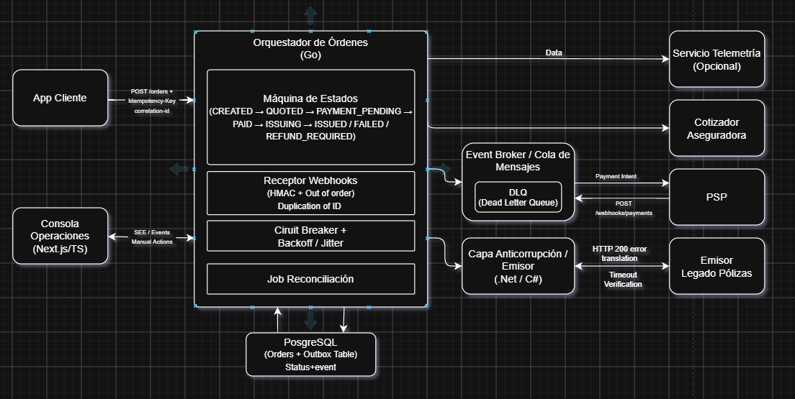
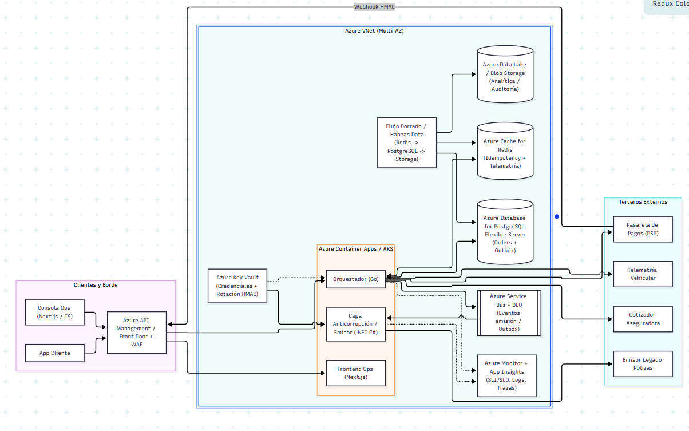

# vehicular-insurance-platform
E2E vehicle insurance orchestration platform (Go, C#/.NET, Next.js, Docker Compose, and AWS architecture)

## Diagrama de arquitectura

### Flujo del sistema de compra de pólizas

### Arquitectura objetivo en Azure

